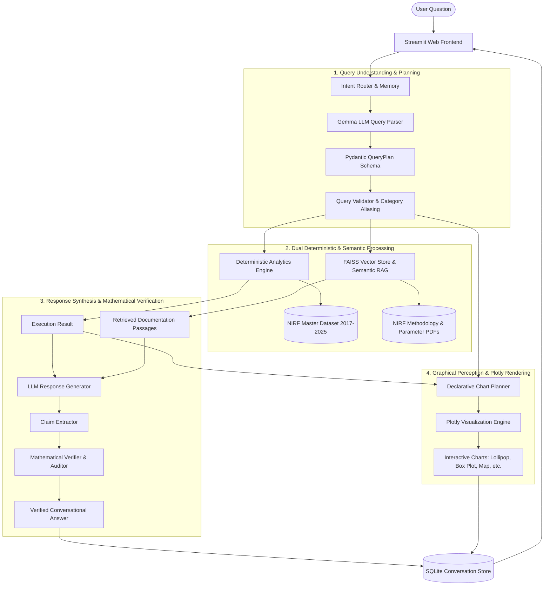

# NIRF Analytics Chatbot: End-to-End System Architecture & Technology Stack Guide

## 1. Executive Summary & Design Paradigm

The **NIRF Analytics & Visualization Platform** is an enterprise-grade conversational AI assistant designed to explore, analyze, and visualize India's National Institutional Ranking Framework (NIRF) data across **9 assessment editions (2017–2025)**.

Unlike naive LLM wrappers that hallucinate facts or guess rankings, this system is engineered around a **hybrid deterministic-semantic architecture**:



---

## 2. End-to-End Query Lifecycle (Step-by-Step)

When a user asks a question (e.g., *"give me ranking of all engineering colleges in 2024, generate a lollipop graph to show"*):

### Step 1: Session Management & Intent Classification
- **Module**: [`src/conversation/session_manager.py`](file:///Users/mohammadrehan/Documents/DHV%20Project/src/conversation/session_manager.py) & [`src/conversational/intent_router.py`](file:///Users/mohammadrehan/Documents/DHV%20Project/src/conversational/intent_router.py)
- Retrieves previous conversational context from SQLite.
- Classifies whether the prompt is an **Analytical Query** (requires computations), a **Conversational Follow-up** (requires pronouns/context resolution), or **Chit-chat/Greetings**.

### Step 2: Query Parsing & Validation (Phase 2 & 3)
- **Module**: [`src/query_engine/parser.py`](file:///Users/mohammadrehan/Documents/DHV%20Project/src/query_engine/parser.py) & [`src/query_engine/validator.py`](file:///Users/mohammadrehan/Documents/DHV%20Project/src/query_engine/validator.py)
- Uses an instruction-tuned LLM (Gemma via Ollama) to translate free-form text into a strictly validated **Pydantic DAG Plan** (`QueryPlan`).
- Extracts target categories, assessment years, metrics, institution entities, and desired chart types (`preferred_chart_type`).
- **Canonical Aliasing**: Resolves informal shorthand (e.g., `"research"` $\rightarrow$ `"Research Institutions"`, `"agri"` $\rightarrow$ `"Agriculture & Allied Sectors"`).

### Step 3: Semantic RAG Retrieval (Phase 5)
- **Module**: [`src/rag/retriever.py`](file:///Users/mohammadrehan/Documents/DHV%20Project/src/rag/retriever.py) & [`src/rag/vector_store.py`](file:///Users/mohammadrehan/Documents/DHV%20Project/src/rag/vector_store.py)
- Performs vector similarity search over chunked NIRF methodology manuals and parameter guidelines stored in **FAISS**.
- Retrieves exact parameter weightings, official metric formulas, and tie-breaking criteria tagged with citation identifiers (`[CITE-01]`, `[CITE-02]`).

### Step 4: Deterministic Analytical Execution (Phase 4)
- **Module**: [`src/execution/executor.py`](file:///Users/mohammadrehan/Documents/DHV%20Project/src/execution/executor.py) & [`src/analytics/engine.py`](file:///Users/mohammadrehan/Documents/DHV%20Project/src/analytics/engine.py)
- Dispatches execution to dedicated Python/Pandas functions. **The LLM never performs arithmetic or ranking directly**.
- Runs exact statistical algorithms (means, medians, IQR, Pearson correlations, rank changes, transitions) against the cleaned master dataset.

### Step 5: Natural Language Synthesis & Empirical Verification (Phase 6 & 6.1)
- **Module**: [`src/response/generator.py`](file:///Users/mohammadrehan/Documents/DHV%20Project/src/response/generator.py) & [`src/response/verifier.py`](file:///Users/mohammadrehan/Documents/DHV%20Project/src/response/verifier.py)
- The LLM synthesizes an articulate ChatGPT-style response grounded *solely* in the execution output and retrieved citations.
- **Claim Extraction & Automated Audit**: Every number, rank, and percentage stated in the answer is extracted and verified against the execution result before being displayed to the user.

### Step 6: Interactive Plotly Visualizations (Phase 7)
- **Module**: [`src/visualization/chart_planner.py`](file:///Users/mohammadrehan/Documents/DHV%20Project/src/visualization/chart_planner.py) & [`src/visualization/plotly_renderer.py`](file:///Users/mohammadrehan/Documents/DHV%20Project/src/visualization/plotly_renderer.py)
- Translates the analytical data into publication-quality **Plotly Graph Objects**.
- Respects graphical perception principles (Cleveland & McGill, Edward Tufte Data-Ink ratio).
- Supports 10 chart formats: **Lollipop, Box & Whisker, Horizontal Bar, Histogram, Scatter, Longitudinal Line, Grouped Bar, Geographic Map of India, Heatmap, and Tables**.

### Step 7: Persistence & Rendering
- **Module**: [`scripts/nirf_query_playground.py`](file:///Users/mohammadrehan/Documents/DHV%20Project/scripts/nirf_query_playground.py)
- Persists the turn in SQLite, updates conversation history, and renders the assistant response, interactive Plotly charts, and audit telemetry in the Streamlit UI.

---

## 3. Technology Stack & Design Rationale

| Layer | Technology | Why We Chose It | Key Role in System |
| :--- | :--- | :--- | :--- |
| **Frontend Framework** | **Streamlit** (v1.30+) | Rapid, Python-native reactive UI; built-in component state management; seamless Plotly container integration without needing Node.js/React. | Powers the user interface, real-time query input, chat history, and telemetry sidebar. |
| **Data Visualization** | **Plotly Graph Objects & Express** | Client-side interactive canvas (zoom, pan, responsive hover tooltips, SVG export); supports custom shapes, geographic maps, and dynamic heights. | Renders interactive Lollipop charts, Box plots, Histograms, India scattergeo maps, and Longitudinal trajectories. |
| **Local LLM Engine** | **Ollama / Gemma Client** | Privacy-first local execution without recurring API fees; strict adherence to system prompts and JSON schema outputs. | Powers Query Parsing (Phase 2) and Conversational Answer Synthesis (Phase 6). |
| **Data Schema Validation** | **Pydantic v2** | Blazing-fast Rust-based data validation; enforces strict type safety on query plans, analytical arguments, and verification results. | Guarantees that LLM outputs match system schemas before code execution occurs. |
| **Numerical Processing** | **Pandas, NumPy, SciPy** | Vectorized computations on structured tabular data; industry standard for quantiles, correlations, and distribution moments. | Executes all 10 analytical engines across 2017–2025 NIRF rankings. |
| **Vector Search (RAG)** | **FAISS (Facebook AI Similarity Search)** | High-performance sub-millisecond similarity search over dense vector embeddings; zero external server overhead. | Indexes NIRF PDF methodology documents for fast semantic context retrieval. |
| **Text Embeddings** | **Sentence-Transformers** (`all-MiniLM-L6-v2`) | Compact, highly accurate 384-dimensional dense semantic vectors capable of running efficiently on local CPU/Apple Silicon. | Encodes NIRF documentation chunks into vector representations for semantic search. |
| **State Persistence** | **SQLite 3** | Zero-configuration, serverless, ACID-compliant relational storage embedded directly into the workspace. | Stores conversation sessions, past turns, query execution plans, and context windows across reloads. |
| **Testing & QA** | **Pytest** | Modular fixture-based testing framework with async, typeguard, and mutation testing extensions. | Over 400 test cases ensuring zero-fabrication, schema compliance, and rendering stability. |

---

## 4. Codebase Directory Structure & Module Map

```text
DHV Project/
├── run.sh                          # One-click startup shell script (environment detection & auto-port)
├── cleaning_script.py              # Data pipeline cleaning raw NIRF Excel/PDF scrapes (2017-2025)
├── requirements.txt                # System dependencies and versions
├── pytest.ini                      # Test runner configuration
│
├── .streamlit/
│   └── config.toml                 # Soothing Sage green UI theme palette and styling
│
├── data/                           # Curated NIRF datasets, caches, and test fixtures
├── database/                       # Persistent SQLite database (`nirf_conversations.db`)
├── knowledge_base/                 # Source official NIRF methodology PDFs and parameters
├── vector_store/                   # Serialized FAISS indices and document chunks
│
├── src/                            # Core Application Logic
│   ├── data/                       # Data Access & Normalization Layer (Phase 1)
│   │   ├── loader.py               # Master dataset loader and schema normalizer
│   │   ├── comparability.py        # Validates longitudinal comparability across category changes
│   │   └── preprocessor.py         # Standardizes institute names, cities, and states
│   │
│   ├── analytics/                  # Deterministic Analytics Engine (Phase 4)
│   │   ├── engine.py               # Facade aggregating all analytical operations
│   │   ├── performance.py          # Category cohort rankings and parameter summaries
│   │   ├── trends.py               # Longitudinal institutional trajectory tracker
│   │   ├── rankings.py             # Rank gainers, decliners, and movement magnitudes
│   │   ├── geography.py            # State-wise institutional density and regional distribution
│   │   ├── distributions.py        # Score moments, IQR, quartiles, and histogram bins
│   │   ├── correlations.py         # Pearson parameter associations (e.g. TLR vs RPC)
│   │   ├── outliers.py             # Statistical outlier detection (Z-score / IQR fences)
│   │   ├── transitions.py          # Rank band transition probability matrices
│   │   ├── category_evolution.py   # Historical tracking of when new disciplines appeared
│   │   └── utils.py                # Acronym shortener (e.g. "IIT (BHU) Varanasi")
│   │
│   ├── rag/                        # Retrieval-Augmented Generation Layer (Phase 5)
│   │   ├── chunker.py              # Semantic markdown and text chunking
│   │   ├── embedder.py             # Sentence-Transformers dense embedding wrapper
│   │   ├── vector_store.py         # FAISS vector store manager and persistent indexer
│   │   └── retriever.py            # Hybrid similarity search and citation injector
│   │
│   ├── query_engine/               # Query Parsing & Intent Routing Layer (Phase 2 & 3)
│   │   ├── parser.py               # Natural language to Pydantic QueryPlan parser
│   │   ├── validator.py            # Parameter bounds check & canonical category aliasing
│   │   ├── schemas.py              # Pydantic schemas (AnalyticalOperation, VisualizationPreference)
│   │   └── prompts.py              # Few-shot prompts for query planning and chart detection
│   │
│   ├── execution/                  # Analytical Plan Execution Layer (Phase 4)
│   │   ├── executor.py             # DAG execution coordinator with dependency resolution
│   │   └── result_schema.py        # Structured OperationResult and ExecutionResult models
│   │
│   ├── response/                   # Conversational Synthesis & Verification (Phase 6 & 6.1)
│   │   ├── generator.py            # ChatGPT-style grounded response synthesizer
│   │   ├── claim_extractor.py      # Extracts numerical statements from generated text
│   │   ├── verifier.py             # Reconciles extracted claims against analytical facts
│   │   └── prompts.py              # Generation and verification system prompts
│   │
│   ├── visualization/              # Graphical Perception & Rendering Layer (Phase 7)
│   │   ├── visualization_service.py # End-to-end chart planning and rendering coordinator
│   │   ├── chart_planner.py        # Selects appropriate chart type based on query semantics
│   │   ├── plotly_renderer.py      # Plotly Graph Objects renderer (Lollipop, Box, Map, etc.)
│   │   ├── chart_schema.py         # Declarative ChartSpecification schema
│   │   └── geo_data.py             # Geocoding dictionary for Indian states and cities
│   │
│   ├── conversation/               # Conversation Memory & Persistence (Phase 8)
│   │   ├── session_manager.py      # Multi-turn context manager and query resolver
│   │   ├── sqlite_store.py         # Relational database interface for turns and sessions
│   │   └── models.py               # Session and turn data structures
│   │
│   └── llm/                        # Unified Model Client Layer
│       ├── client.py               # Abstract LLM client interface
│       └── gemma_client.py         # Ollama / Local Gemma implementation
│
├── scripts/
│   ├── nirf_query_playground.py    # Production Streamlit Web Application
│   └── evaluate_rag.py             # Evaluation and benchmarking scripts
│
└── tests/                          # 400+ Unit, Integration, and Mutation Tests
    ├── test_visualization.py       # Visualization planner and Plotly renderer tests
    ├── test_map_visualization.py   # India geographic map tests
    ├── test_query_validator.py     # Schema validation and category aliasing tests
    └── test_analytics_*.py         # Math and statistical correctness tests
```

---

## 5. Architectural Invariants & Safeguards

1. **Zero Hallucination Guarantee**:
   The LLM is strictly prohibited from guessing numbers or computing rankings. If data is missing or an institution wasn't ranked in that edition, the system explicitly reports missingness rather than inventing a rank.

2. **No Data Fabrication**:
   Null, absent, or unranked instances are never coerced to zero. Missing years in longitudinal trajectories are broken with `None` gaps so lines never interpolate across unverified periods.

3. **Inverted Rank Perception**:
   In graphical perception, rank #1 represents the best standing. Standard Cartesian plots place lower numbers at the bottom. Our renderer explicitly inverts rank Y-axes so Rank #1 is always plotted at the pinnacle.

4. **Adaptive Visual Spacing & Anti-Overcrowding**:
   - For massive cohorts (e.g., 100 Engineering colleges), traditional vertical bar charts jam labels into unreadable smudges.
   - The engine automatically pairs large cohorts with **Lollipop Charts** or **Horizontal Bar Charts** with dynamic height scaling (`height = len(df) * 22px`), giving every single institution its own spacious, scrollable lane.
   - Long 50-character institution names are dynamically abbreviated on axes (e.g. `IIT (BHU) Varanasi`, `NIT Trichy`, `IISc Bangalore`) while preserving full institutional names in hover tooltips.
