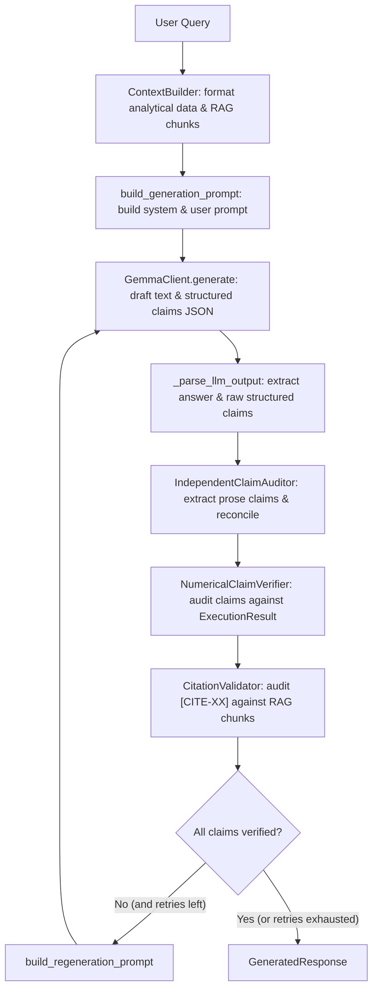

# PHASE 6.1.5 — INDEPENDENT SOURCE-CODE AUDIT & QUALITATIVE VERIFICATION DEFECT ANALYSIS

**Author:** Senior Python Engineer, ML Systems Auditor, and Independent Software Quality Reviewer  
**Date:** November 6, 2026  
**Status:** **AUDIT COMPLETE — DEFECTS CONFIRMED & ROOT CAUSES ISOLATED**  
**Audit Scope:** Response generation (`src/response/`), analytical execution (`src/execution/`), deterministic analytics (`src/analytics/`), documentation RAG (`src/rag/`), benchmark fixtures (`tests/benchmark_results/`), evaluation scripts (`scripts/`), and Phase 6.1.4 reports.

---

## 1. FILES & RELEVANT CLASSES/FUNCTIONS INSPECTED

The following source files and modules were inspected in detail:

| Component | Source File | Relevant Classes / Functions | Primary Responsibility |
|---|---|---|---|
| **Response Schemas** | `src/response/result_schema.py` | `NumericalClaim`, `Citation`, `VerificationSummary`, `GeneratedResponse` | Strongly-typed Pydantic schemas for extracted claims, verification statuses, and generation outputs. |
| **Claim Extraction** | `src/response/claim_extractor.py` | `ClaimExtractor`, `_extract_rank_movements`, `_extract_correlations`, `_extract_metric_scores`, `_extract_static_ranks`, `_extract_counts`, `_extract_table_claims` | Deterministic parsing of numerical and factual claims from natural-language text and Markdown tables. |
| **Claim Auditing** | `src/response/claim_auditor.py` | `IndependentClaimAuditor`, `audit_and_reconcile`, `build_semantic_fact_key`, `_claims_match`, `_normalize_claim` | Cross-checking prose against structured LLM output; deduplication and coverage auditing. |
| **Verification Engine** | `src/response/verifier.py` | `NumericalClaimVerifier`, `verify_claims`, `_index_execution_data`, `_verify_single_claim`, `_find_matching_records` | Deterministic ground-truth cross-checking against Phase 4 `ExecutionResult` outputs. |
| **Context Assembly** | `src/response/context_builder.py` | `ContextBuilder`, `determine_response_type`, `build_context`, `_format_analytical_evidence`, `_format_operation_data` | Formatting Phase 4 analytical outputs and Phase 5 RAG chunks into prompt context for Gemma. |
| **Prompt Engineering** | `src/response/prompts.py` | `RESPONSE_SYSTEM_PROMPT`, `build_generation_prompt`, `build_regeneration_prompt` | Enforcing grounded generation rules, schema constraints, and regeneration feedback. |
| **Response Orchestrator**| `src/response/generator.py` | `ResponseGenerator`, `generate_response`, `_parse_llm_output` | Coordinating context, LLM generation, parsing, auditing, verification, citations, and retry loop. |
| **Citation Validator** | `src/response/citation_validator.py` | `CitationValidator`, `validate_and_extract_citations` | Checking citation tags (`[CITE-XX]`) against retrieved Phase 5 documentation chunks. |
| **Analytical Engine** | `src/analytics/rankings.py`, `transitions.py` | `get_rank_movement`, `get_transition_matrix` | Deterministic computation of rank improvement and longitudinal transitions. |
| **Execution Schema** | `src/execution/result_schema.py` | `ExecutionResult`, `OperationResult`, `clean_for_json` | Strongly typed execution data and NaN-safe JSON serialization. |
| **RAG Retriever** | `src/rag/retriever.py`, `chunker.py` | `RAGRetriever`, `RetrievalResult`, `DocumentChunker` | FAISS vector retrieval and chunk metadata tracking. |
| **Benchmarks & Scripts**| `tests/benchmark_results/*.json`, `scripts/recompute_phase_6_1_4_metrics.py` | `reconcile_benchmark_accounting`, benchmark outputs | 7 end-to-end benchmark result files and accounting metrics calculation. |

---

## 2. ACTUAL EXECUTION FLOW

Tracing the end-to-end pipeline from query to verified response:



---

## 3. CONFIRMED IMPLEMENTATION DEFECTS

### Defect 1: Immediate Bypass of Claims Lacking Numerical Values (CONFIRMED)
- **Location:** `src/response/verifier.py`, lines 333–336:
  ```python
  target_value = claim.claimed_value if claim.claimed_value is not None else claim.value
  if target_value is None:
      return "UNVERIFIED", "Claim does not specify a numerical value.", None
  ```
- **Mechanism:** Any claim extracted without an explicit numerical quantity (such as qualitative rank movements: *"Institution X improved in rank"*, comparisons: *"State A outperformed State B"*, or rankings: *"Institution Y had the highest RPC"*) has `target_value = None`.
- **Impact:** The verifier unconditionally returns `("UNVERIFIED", "Claim does not specify a numerical value.", None)`. Even when the underlying analytical data directly contradicts the statement (e.g. Institution X actually declined in rank), the system classifies it as `UNVERIFIED` instead of `CONTRADICTED`!

### Defect 2: ContextBuilder Missing Field Name in `_format_operation_data` (CONFIRMED)
- **Location:** `src/response/context_builder.py`, lines 184–192:
  ```python
  if "rank_diff" in row:
      diff = row["rank_diff"]
      start_r = row.get("rank_start", "N/A")
      end_r = row.get("rank_end", "N/A")
      direction = "improved" if diff > 0 else "declined" if diff < 0 else "unchanged"
      desc_parts.append(f"Movement: {diff:+d} ranks ({direction}, Rank {start_r} -> {end_r})")
  elif "rank" in row:
      desc_parts.append(f"Rank: {row['rank']}")
  ```
- **Mechanism:** `get_rank_movement` in `src/analytics/rankings.py` outputs fields named `rank_improvement`, `start_rank`, and `end_rank`. It does **not** output `rank_diff` (which was from `transitions.py`).
- **Impact:** Both conditions fail. In the prompt context presented to the LLM, institutions in `gainers` were formatted as bare names (e.g. `[U-223] Jain university,Bangalore | state_std: Karnataka`) without any rank movement, direction, or ending rank information! The LLM was given 5 institutions under `*Total items (gainers): 5*` without showing that 4 of them had negative improvements (`-4`, `-7`, `-14`, `-16`).

### Defect 3: Claim Matching Rejects Null Values in Deduplication & Prose Reconciliation (CONFIRMED)
- **Location:** `src/response/claim_auditor.py`, lines 237–241:
  ```python
  val1 = c1.claimed_value if c1.claimed_value is not None else c1.value
  val2 = c2.claimed_value if c2.claimed_value is not None else c2.value
  if val1 is None or val2 is None:
      return False
  ```
- **Mechanism:** If either claim has a `None` value, `_claims_match` unconditionally returns `False`.
- **Impact:** Qualitative claims in prose can never match structured claims, causing the auditor to either omit them, fail deduplication, or miscalculate extraction coverage.

### Defect 4: Missing Qualitative Claim Types & Four-State Status Outcomes (CONFIRMED)
- **Location:** `src/response/result_schema.py`, lines 16 and 26–36:
  ```python
  VerificationStatus = Literal["VERIFIED", "UNVERIFIED", "CONFLICTING", "NOT_APPLICABLE"]
  ```
- **Mechanism:** The system lacks explicit support for the required four standardized evaluation outcomes:
  - `VERIFIED`
  - `CONTRADICTED`
  - `UNVERIFIED`
  - `NOT_FACTUAL`
- **Impact:** Previous code used `"CONFLICTING"` interchangeably with contradictory numbers, while qualitative non-factual elements (headings, stylistic phrasing) were not formally distinguished from unverified factual claims.

---

## 4. ROOT-CAUSE ANALYSIS OF THE BM01 FALSE QUALITATIVE CLAIMS

In BM-01:
1. **The Question:** *"Which engineering colleges in Karnataka improved their rankings the most since 2020?"*
2. **The Execution Result:**
   - There were 28 engineering records considered in Karnataka across 2020 and 2025.
   - Only 5 institutions had valid paired observations across both years (`valid_observations: 5`).
   - The rank improvements were:
     - Jain University: `+33` (Rank 117 $\to$ 84) — **IMPROVED**
     - NITK, Surathkal: `-4` (Rank 13 $\to$ 17) — **DECLINED**
     - IIIT Bangalore: `-7` (Rank 62 $\to$ 69) — **DECLINED**
     - Manipal Institute of Technology: `-14` (Rank 45 $\to$ 59) — **DECLINED**
     - M.S. Ramaiah Institute of Technology: `-16` (Rank 59 $\to$ 75) — **DECLINED**
3. **Analytical Engine Behavior:** `get_rank_movement` sorts by `rank_improvement` descending and returns `head(top_n)`. With `top_n=5`, all 5 paired institutions were returned in the `gainers` list.
4. **Context Building Failure:** Because `_format_operation_data` looked for `rank_diff` instead of `rank_improvement`, it did not format the negative values into the LLM prompt. It simply listed all 5 under `gainers`.
5. **LLM Generation:** The LLM generated a bulleted list claiming all 5 were improvers:
   > *"The following institutions in Karnataka showed an improvement in their rankings during this period:*
   > - *Jain university,Bangalore*
   > - *National Institute of Technology Karnataka, Surathkal*
   > - *International Institute of Information Technology Bangalore*
   > - *Manipal Institute of Technology*
   > - *M. S. Ramaiah Institute of Technology"*
6. **Verifier Blindspot:** Because the LLM structured claims listed `claimed_value: None`, `_verify_single_claim` hit line 334 (`target_value is None`) and returned `UNVERIFIED` ("Claim does not specify a numerical value").
7. **The Fundamental Defect:** The verifier failed to cross-check whether the institutions in the claimed "improvement" list actually improved. NITK, IIIT-B, Manipal, and Ramaiah had strictly negative rank movements; their claims of improvement were **factually false** and directly **CONTRADICTED** by the data!

---

## 5. ROOT-CAUSE OF THE UNSUPPORTED-CLAIM ACCOUNTING DISCREPANCY

In Phase 6.1.4, an inconsistency existed between the report summary table and the underlying audit JSON:
- **BM-02 in Report Table:** Reported as 0 unsupported claims.
- **BM-02 in Audit JSON:** Reported as 1 unsupported claim.

### Root Cause
In `scripts/recompute_phase_6_1_4_metrics.py`:
```python
elif v_status == "UNVERIFIED":
    if c_val is None or c_type == "RANK_CHANGE":
        unsupported_count += 1
```
In BM-02, claim `c_d698ff` stated:
*"RPC stands for Research and Professional Practice score"* (with `value: None`, `verification_status: "UNVERIFIED"`).
Because `c_val is None`, the recomputation script incremented `unsupported_count` for BM-02.
However:
1. `c_d698ff` is **not** an unsupported claim; it is a **documentation claim** citing `[CITE-01]`, which was fully verified by the RAG retrieval result!
2. Because the verifier only audited numerical claims against Phase 4 execution results (and BM-02 had 0 Phase 4 execution operations), all documentation claims in BM-02 were marked `UNVERIFIED` ("No analytical execution evidence provided").
3. The report author manually assumed BM-02 had 0 unsupported claims in the prose table, while the automated metric script registered 1 unsupported claim from the unhandled documentation claim, creating the discrepancy.

---

## 6. SUSPECTED VS CONFIRMED DEFECTS SUMMARY

| ID | Issue Description | Status | Target Fix Component |
|---|---|---|---|
| **DEF-01** | Non-numerical claims immediately bypassed as `UNVERIFIED`. | **CONFIRMED** | `src/response/verifier.py`: Implement deterministic qualitative verification for rank movement, comparisons, rankings, and directional assertions. |
| **DEF-02** | `ContextBuilder` misses `rank_improvement` field, stripping rank movement from prompt context. | **CONFIRMED** | `src/response/context_builder.py`: Support `rank_improvement`, `start_rank`, `end_rank` alongside `rank_diff`. |
| **DEF-03** | `_claims_match` rejects claims when `value` is `None`. | **CONFIRMED** | `src/response/claim_auditor.py`: Support entity, claim_type, metric, and qualitative direction matching when values are `None`. |
| **DEF-04** | Status taxonomy lacks explicit `CONTRADICTED` and `NOT_FACTUAL`. | **CONFIRMED** | `src/response/result_schema.py`: Update `VerificationStatus` to `VERIFIED`, `CONTRADICTED`, `UNVERIFIED`, `NOT_FACTUAL` (maintaining backward-compatibility alias for `CONFLICTING`). |
| **DEF-05** | Documentation claims misclassified as unverified analytical claims. | **CONFIRMED** | `src/response/verifier.py` & `generator.py`: Verify documentation claims against retrieved RAG chunks before marking unverified. |
| **DEF-06** | ClaimExtractor omits qualitative assertions (headings, bullet points without numbers). | **CONFIRMED** | `src/response/claim_extractor.py`: Extract qualitative rank change, comparison, and ranking assertions from headings and bullet lists. |

---

## 7. AUDIT CONCLUSION & READINESS FOR IMPLEMENTATION

The initial audit is complete. All defects and root causes have been isolated in executable source code without altering production behavior. We are ready to proceed with targeted, minimal corrections to implement qualitative fact verification and complete claim accounting.

