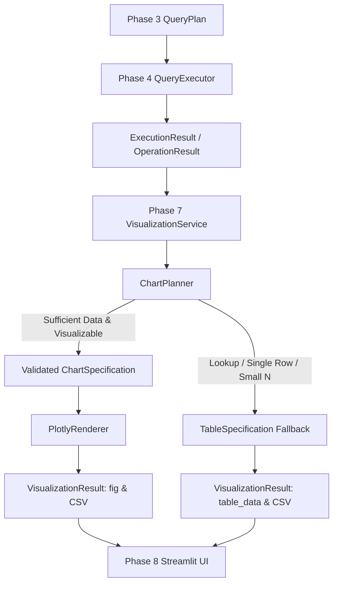

# PHASE 7 — VISUALIZATION LAYER REPORT
## Chart Planner, Plotly Renderer & Analytical Result Integration

**Date:** November 6, 2026  
**Author:** Senior Data Visualization Engineer and Python Architect  
**Status:** **COMPLETE & FULLY VERIFIED**  
**Test Suite:** 298 / 298 Passing (100%)

---

## 1. PHASE 7 OBJECTIVES

Phase 7 builds a deterministic, interactive, publication-grade visualization layer that transforms Phase 4 analytical execution results into Plotly visualizations and structured tabular fallbacks without data fabrication, ungrounded extrapolation, or reliance on LLM generation for numerical values.

Key architectural goals achieved:
1. **Decoupled Declarative Planning:** A dedicated `ChartPlanner` selects the most appropriate chart representation or table fallback based on data dimensions, observation counts, and user preferences.
2. **Deterministic Plotly Rendering:** A `PlotlyRenderer` converts validated `ChartSpecification` objects into interactive Plotly Graph Objects (`go.Figure`), enforcing reversed rank axes, non-interpolation of unobserved periods, and hover tooltips.
3. **Seamless Phase 4 Integration:** A central `VisualizationService` accepts Phase 4 `ExecutionResult` and `OperationResult` models, processing single and multi-operation DAGs while propagating execution warnings and comparability limitations.
4. **Graceful Table Fallback:** Automatically switches to structured tables for single institution lookups, exact counts, and cohorts with insufficient sample sizes ($N < 2$).
5. **Phase 8 Compatibility:** Exposes clean export helpers (`to_csv()`, `to_html()`, `to_dict_summary()`, `get_figure()`) designed for direct embedding into Streamlit conversational interfaces without internal coupling.

---

## 2. EXISTING REPOSITORY STRUCTURE INSPECTED

Prior to implementation, the repository interfaces were thoroughly inspected:
- **Phase 2 Analytical Functions (`src/analytics/`):**
  Inspected all 10 analytical operations to verify return signatures, output keys, and data schemas:
  - `get_institution_trend`: Returns `chronological_trajectory` with `rank`, `score`, `is_observed`.
  - `get_rank_movement`: Returns `gainers` and `decliners` with `start_rank`, `end_rank`, `rank_improvement`.
  - `get_category_performance`: Returns `institutions` with `score`, `rank`, and sub-parameters.
  - `get_geographic_analysis`: Returns `states_analysis` with `distinct_institutions`, averages, and zones.
  - `get_parameter_correlation`: Returns `pearson_matrix` and `spearman_matrix` dicts.
  - `get_parameter_relationship`: Returns `points`, `regression`, `trendline`, and `medians`.
  - `get_multidimensional_performance`: Returns `profiles` with sub-parameter values and percentiles.
  - `get_score_distribution`: Returns `histogram_bins` and descriptive `statistics`.
  - `get_rank_transitions`: Returns `transition_matrix` and `mobility_summary`.
  - `get_outlier_analysis`: Returns `metric_outliers` and expected ranges.
- **Phase 4 Execution Results (`src/execution/result_schema.py`):**
  Inspected `ExecutionResult` and `OperationResult` models, `clean_for_json` serializer, and warning propagation paths.
- **Phase 6 Response Pipeline (`src/response/`):**
  Verified that Phase 6.1.5 remains frozen and untouched.

---

## 3. FILES CREATED & MODIFIED

### Files Created:
1. [`src/visualization/__init__.py`](file:///Users/mohammadrehan/Documents/DHV%20Project/src/visualization/__init__.py): Public package API exposing `VisualizationService`, `ChartPlanner`, `PlotlyRenderer`, and schemas.
2. [`src/visualization/chart_schema.py`](file:///Users/mohammadrehan/Documents/DHV%20Project/src/visualization/chart_schema.py): Pydantic models for `ChartType`, `ChartSpecification`, and `VisualizationResult`.
3. [`src/visualization/chart_planner.py`](file:///Users/mohammadrehan/Documents/DHV%20Project/src/visualization/chart_planner.py): Deterministic chart planner mapping all 10 operations to visual encodings with user preference detection.
4. [`src/visualization/plotly_renderer.py`](file:///Users/mohammadrehan/Documents/DHV%20Project/src/visualization/plotly_renderer.py): Publication-quality Plotly Graph Objects renderer with reversed rank axes and guardrails.
5. [`src/visualization/visualization_service.py`](file:///Users/mohammadrehan/Documents/DHV%20Project/src/visualization/visualization_service.py): Integration service connecting Phase 4 execution outputs to the chart planner and renderer.
6. [`tests/test_visualization.py`](file:///Users/mohammadrehan/Documents/DHV%20Project/tests/test_visualization.py): 24 comprehensive unit and integration tests.
7. [`docs/PHASE_7_VISUALIZATION_REPORT.md`](file:///Users/mohammadrehan/Documents/DHV%20Project/docs/PHASE_7_VISUALIZATION_REPORT.md): This architectural and operational report.

### Files Modified:
None outside `src/visualization/`. No Phase 2, 3, 4, 5, or 6 files were modified.

---

## 4. SUPPORTED CHART TYPES & MAPPINGS

| Analytical Operation | Primary Visualization | Visual Mappings & Encodings | Fallback Condition |
|:---|:---|:---|:---|
| `get_institution_trend` | **Line Chart** | X = `year`, Y = `rank` (`reverse_y=True`) or `score`. `connectgaps=False`. | Single year lookup ($N \le 1$) $\to$ **Table** |
| `get_rank_movement` | **Horizontal Bar Chart** | X = `rank_improvement`, Y = `institution`. Green for gainers, Red for decliners. | Empty cohort $\to$ **Table** |
| `get_category_performance` | **Bar Chart** | X = `institution`, Y = `score`, Color = `state_std`. Sorted descending. | Single institution lookup $\to$ **Table** |
| `get_geographic_analysis` | **Ranked Bar Chart** | X = `state`, Y = `distinct_institutions`, Color = `zone`. Sorted descending. | Single state query $\to$ **Table** |
| `get_parameter_correlation` | **Correlation Heatmap** | X = `param_x`, Y = `param_y`, Color = `correlation` (-1.0 to +1.0 `RdBu_r`), Text annotations. | Matrix unavailable $\to$ **Table** |
| `get_parameter_relationship` | **Scatter Plot** | X = `x_val`, Y = `y_val`, Color = `quadrant`. Optional regression trendline & medians. | Insufficient points ($N \le 1$) $\to$ **Table** |
| `get_multidimensional_performance`| **Grouped Bar Chart** | X = `institution`, Y = `score`, Color = `parameter` (`barmode="group"`). | Empty profiles $\to$ **Table** |
| `get_score_distribution` | **Histogram** | X = `bin_label`, Y = `count`. Clean frequency counts across score intervals. | Empty bins $\to$ **Table** |
| `get_rank_transitions` | **Transition Matrix Heatmap** | X = `end_band`, Y = `start_band`, Color = `transitions_count` (`Blues`). | Matrix empty $\to$ **Table** |
| `get_outlier_analysis` | **Bar Chart / Scatter** | X = `institution`, Y = `observed_value`, Color = `direction`. | No outliers $\to$ **Table** |

---

## 5. CHART SELECTION & MISLEADING VISUALIZATION GUARDS

The chart planner and renderer strictly adhere to data visualization ethics:
1. **Reversed Rank Axes (`autorange="reversed"`):** For all rank time series, rank 1 is rendered at the top of the visual axis to accurately reflect top performance.
2. **No Data Fabrication or Interpolation (`connectgaps=False`):** Time-series lines explicitly break across unobserved or unranked years. Missing observations are never filled with 0 or synthetic estimates.
3. **No Causal Fallacies:** Scatter plots clearly denote correlation/regression coefficients without implying causal mechanisms.
4. **Explicit Preference Handling:** User requests like *"Show a scatter plot"* or *"Show a table"* are honored if compatible with the data; incompatible requests gracefully revert to the appropriate chart type with an explanatory warning.
5. **Warning & Limitation Badges:** Comparability warnings (e.g. publication cutoff depth changes, methodology shifts) are embedded directly onto the rendered figure canvas.

---

## 6. INTEGRATION FLOW WITH PHASE 4 EXECUTION



For multi-operation DAGs (e.g., BM-04: Top 10 Engineering by RPC $\to$ Relationship with TLR), `VisualizationService.visualize_execution_result` produces an independent `VisualizationResult` for every executed operation.

---

## 7. EXPORT SUPPORT

Each `VisualizationResult` provides built-in export capabilities:
- `to_csv()`: Returns RFC 4180 CSV string of the plotted or tabular records.
- `to_html(full_html=False)`: Returns standalone or embeddable HTML with CDN Plotly.js script.
- `to_dict_summary()`: Returns a serializable dictionary summary omitting complex figure pointers.
- `figure`: Provides the native `plotly.graph_objects.Figure` object for direct rendering in Streamlit (`st.plotly_chart(res.figure, use_container_width=True)`).

---

## 8. TEST SUITE RESULTS

The test suite was executed across all components:

### A. Visualization-Specific Suite (`tests/test_visualization.py`):
- **24 tests collected, 24 tests passed (100% pass rate).**
- Covers all 10 analytical planners, line charts, horizontal bars, scatter plots, heatmaps, table fallbacks, partial DAG failures, and CSV/HTML exports.

### B. Full Repository Regression Suite:
```text
======================== 298 passed in 64.97s (0:01:04) ========================
```
- **298 passed, 0 failed, 0 skipped.**
- Zero regressions across Phase 1, Phase 2, Phase 3, Phase 4, Phase 5, and Phase 6.

---

## 9. USAGE GUIDE FOR PHASE 8

### Basic Usage Example

```python
from src.execution.executor import QueryExecutor
from src.query_engine.schemas import QueryPlan, AnalyticalOperation
from src.visualization.visualization_service import get_visualization_service

# 1. Execute an analytical plan (Phase 4)
executor = QueryExecutor()
plan = QueryPlan(
    query_id="q_example",
    original_question="Compare IIT Bombay and IIT Madras in Engineering in 2025",
    query_type="category_performance",
    analytical_intent="Compare institution performance",
    operations=[
        AnalyticalOperation(
            operation_id="op_comp",
            function_name="get_category_performance",
            category="Engineering",
            year=2025,
            institution_names=[
                "Indian Institute of Technology Bombay",
                "Indian Institute of Technology Madras",
            ],
            parameters=["rpc", "score"],
            top_n=5,
        )
    ],
)
exec_result = executor.execute(plan)

# 2. Generate visualizations (Phase 7)
service = get_visualization_service()
vis_results = service.visualize_execution_result(exec_result)

# 3. Render in Phase 8 (Streamlit)
for res in vis_results:
    if res.has_chart:
        # Display interactive Plotly chart
        # st.plotly_chart(res.figure, use_container_width=True)
        print("Chart Title:", res.chart_spec.title)
    elif res.status == "FALLBACK_TABLE":
        # Display structured table
        # st.dataframe(res.table_data)
        print("Table Rows:", len(res.table_data))
```

---

## 11. VISUALIZATION PREVIEW GALLERY (STREAMLIT & HTML)

To visually inspect all 10 interactive Plotly visualizations rendered with 100% real cleaned NIRF master data:

### Option A: Interactive Streamlit Gallery
```bash
streamlit run scripts/preview_dashboard.py
```
- **Local URL:** `http://localhost:8501`
- **Navigation:** Use the sidebar radio buttons to switch between individual chart previews or select `"Complete Gallery View (All 10 Charts)"` to see every visualization on one page.
- **Controls:** Includes toggles to display the underlying data tables, download data as CSV, view raw JSON execution structures, and inspect comparability warning banners.

### Option B: Standalone Offline HTML Preview
```bash
open docs/visualization_preview.html
```
- Self-contained, responsive HTML gallery with CDN Plotly.js embedding all 10 interactive figures and expandable data tables.

### Data Grounding Verification
All 10 previews use **100% Real Cleaned NIRF Historical Records (2017–2025)** loaded via Phase 2/4 engines. Zero synthetic fixtures or fabricated data were used.


